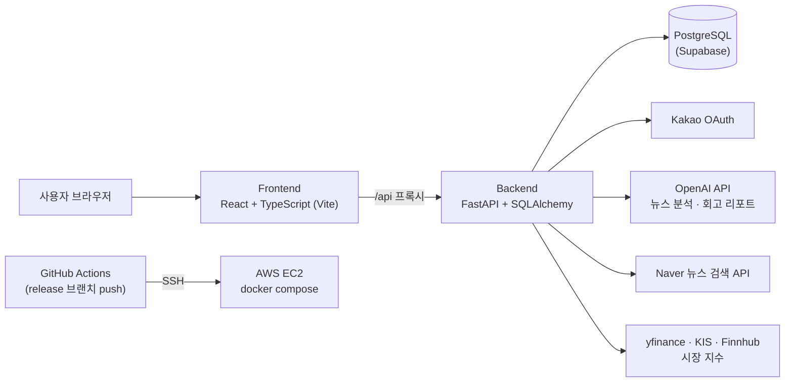

# Fintor — LLM 기반 금융 학습 플랫폼

투자를 처음 시작하는 사용자가 **뉴스 읽기 → 모의투자 → 퀴즈**를 반복하며 금융 지식을 쌓도록 돕는 웹 서비스입니다.
가상의 시장 시나리오 안에서 자산을 배분해 보고, 결과를 점수와 AI 회고 리포트로 돌려받습니다.

> 조선대학교 캡스톤디자인 · 4인 팀 · 2026.03 ~ 2026.06

## 주요 기능

| 기능 | 내용 |
|---|---|
| 카카오 로그인 · 투자 성향 설문 | 카카오 OAuth 로그인 후 신규 회원은 설문으로 투자 성향을 정하고, 성향에 맞는 자산 배분 포트폴리오를 추천받습니다. |
| 대시보드 | 국내외 주요 지수, 24시간 인기 뉴스, 시뮬레이터 진행 상태, 레벨·경험치를 한 화면에 보여 줍니다. |
| 뉴스 | 네이버 뉴스 검색 API로 기사를 모으고, 본문을 OpenAI API로 분석해 카테고리·호재/악재·산업 태그를 붙입니다. 비슷한 제목은 TF-IDF 유사도로 걸러 냅니다. |
| 모의투자 시뮬레이터 | 시나리오(시즌) 안에서 하루씩 뉴스와 거시 지표를 보고 자산 비중을 정합니다. 시즌이 끝나면 수익률·상황 적응·분산·안정성 점수와 AI 회고 리포트를 받습니다. |
| 퀴즈 | 매일 푸는 일일 챌린지와 주간 시즌 랭킹이 있는 시즌 챌린지를 제공합니다. |
| 레벨 · 경험치 | 퀴즈와 시뮬레이터 결과에 따라 경험치를 주고, 100 EXP마다 레벨이 오릅니다. |

## 아키텍처



- 백엔드 시작 시 APScheduler가 **시장 지수 5분, 뉴스 30분, 퀴즈 시즌 경험치 지급 1시간** 간격으로 백그라운드 작업을 돌립니다. → [`backend/main.py`](backend/main.py)
- AI 회고 리포트는 생성 비용이 커서 처음 생성한 결과를 DB에 저장해 두고 다시 사용합니다.
- 비밀값(API 키, DB 주소)은 모두 환경 변수로 읽고, 배포 서버 접속 정보는 GitHub Secrets로 관리합니다.

## 기술 스택

| 구분 | 사용 기술 |
|---|---|
| Frontend | React 18, TypeScript, Vite, React Router, Tailwind CSS, Recharts |
| Backend | FastAPI, SQLAlchemy, APScheduler, PyJWT |
| Database | PostgreSQL (Supabase) |
| AI · 외부 API | OpenAI API, Kakao Login, Naver 뉴스 검색, yfinance, 한국투자증권(KIS) Open API, Finnhub |
| Infra | Docker Compose, AWS EC2, GitHub Actions |

## 팀 구성과 역할

| 팀원 | 역할 | 주요 작업 |
|---|---|---|
| [kimwonwoo1111](https://github.com/kimwonwoo1111) (김원우) | PM · 풀스택 | **백엔드**: 뉴스 수집 파이프라인 구축, 24시간 인기 뉴스, JWT 인증 의존성, 외부 시세 API 호출 제한 대응, 레벨·경험치 산출 로직 · **프론트**: 모의투자 시뮬레이터 4개 화면, 공통 요청 함수 `apiCall`, 대시보드·뉴스 화면, 온보딩 · **협업**: [API 명세서](https://docs.google.com/document/d/1_JoLlr3xXDROh7A50tuofb9pa-6lR53meIGAr-e6uE8/edit) 작성 → [상세](docs/contributions/kimwonwoo1111.md) |
| [ngw12358](https://github.com/ngw12358) | 백엔드 | 카카오 로그인 백엔드, 시뮬레이터 게임 API와 점수 산출, AI 회고 리포트, 퀴즈 백엔드와 시즌 운영, 뉴스 분석 개선(OpenAI 전환, TF-IDF 중복 검사), Supabase 전환과 배포 |
| [dolami12](https://github.com/dolami12) | 백엔드 · 데이터 | 시뮬레이터 시나리오 데이터, 시장 지수 수집, 포트폴리오·레벨 조회 API, 학습 탭, GitHub Actions 자동 배포 |
| [eoqkf](https://github.com/eoqkf) | 디자인 | 로그인 화면 배경 영상, 파비콘 |

## API

API 요청·응답 형식은 [API 명세서(Google Docs)](https://docs.google.com/document/d/1_JoLlr3xXDROh7A50tuofb9pa-6lR53meIGAr-e6uE8/edit)에 정리했습니다. 백엔드를 실행하면 FastAPI가 만드는 문서(`http://localhost:8000/docs`)에서도 전체 엔드포인트를 볼 수 있습니다.

| 영역 | 엔드포인트 | 라우터 |
|---|---|---|
| 인증 | `POST /api/auth/kakao/login`, `POST /api/auth/logout` | [`auth.py`](backend/routers/auth.py) |
| 설문 · 레벨 | `POST /api/survey`, `GET /api/v1/users/{user_id}/level` | [`survey.py`](backend/routers/survey.py) |
| 시장 · 뉴스 | `GET /api/v1/market/indices`, `GET /api/v1/market/news`, `GET /api/v1/market/news/popular`, `POST /api/v1/market/news/{news_id}/view` | [`market.py`](backend/routers/market.py) |
| 시뮬레이터 | `GET /api/game/scenarios`, `POST /api/game/start`, `POST .../allocate`, `POST .../advance-day`, `GET .../score`, `GET .../review` 등 | [`game.py`](backend/routers/game.py) |
| 퀴즈 | `GET /api/quiz/today`, `POST /api/quiz/daily/complete`, `GET /api/quiz/ranking` 등 | [`quiz.py`](backend/routers/quiz.py) |
| 사용자 | `GET /api/user/me`, `PATCH /api/user/nickname`, `DELETE /api/user/me` | [`user.py`](backend/routers/user.py) |

## 실행 방법

**1. 환경 변수**: 저장소 루트에 `.env` 파일을 만들고 아래 값을 채웁니다. `.env`는 `.gitignore`에 포함되어 있습니다.

| 변수 | 용도 |
|---|---|
| `DATABASE_URL` | PostgreSQL(Supabase) 접속 주소 |
| `OPENAI_API_KEY` | 뉴스 분석, AI 회고 리포트 |
| `KAKAO_REST_API_KEY`, `KAKAO_CLIENT_SECRET`, `KAKAO_REDIRECT_URI` | 카카오 로그인 (백엔드) |
| `VITE_KAKAO_REST_API_KEY` | 카카오 로그인 (프론트엔드) |
| `NAVER_CLIENT_ID`, `NAVER_CLIENT_SECRET` | 네이버 뉴스 검색 |
| `KIS_APP_KEY`, `KIS_APP_SECRET`, `KIS_BASE_URL` | 한국투자증권 국내 지수 |
| `FINNHUB_API_KEY` | 해외 시세 |

**2. 실행**

```bash
docker compose up -d --build
```

- 프론트엔드: http://localhost:3000 (Vite 개발 서버가 `/api` 요청을 백엔드로 넘깁니다)
- 백엔드: http://localhost:8000 (API 문서 `/docs`)
- 처음 실행하면 시뮬레이터 시나리오와 퀴즈 문항 시드 데이터가 자동으로 들어갑니다.

## 프로젝트 구조

```
capstone7/
├── backend/
│   ├── main.py              # 앱 생성, 라우터 등록, 시드·스케줄러 시작
│   ├── routers/             # auth, survey, market, game, quiz, user
│   ├── db/                  # SQLAlchemy 모델, 스키마, CRUD
│   ├── utils/               # 시장 지수 수집, 뉴스 파이프라인, 시뮬레이터 점수 산출
│   └── seeds/               # 시나리오·퀴즈 초기 데이터
├── frontend/
│   └── src/app/
│       ├── pages/           # 화면 (Dashboard, News, Simulator*, Quiz, Survey ...)
│       ├── components/      # 공통 컴포넌트 (Header, Sidebar, 투어, 레벨업 모달 ...)
│       └── components/ui/   # UI 컴포넌트 라이브러리 (shadcn/ui 기반 생성 코드)
├── docs/contributions/      # 팀원별 기여 상세
├── docker-compose.yml
└── .github/workflows/deploy.yml   # release 브랜치 → EC2 배포
```
